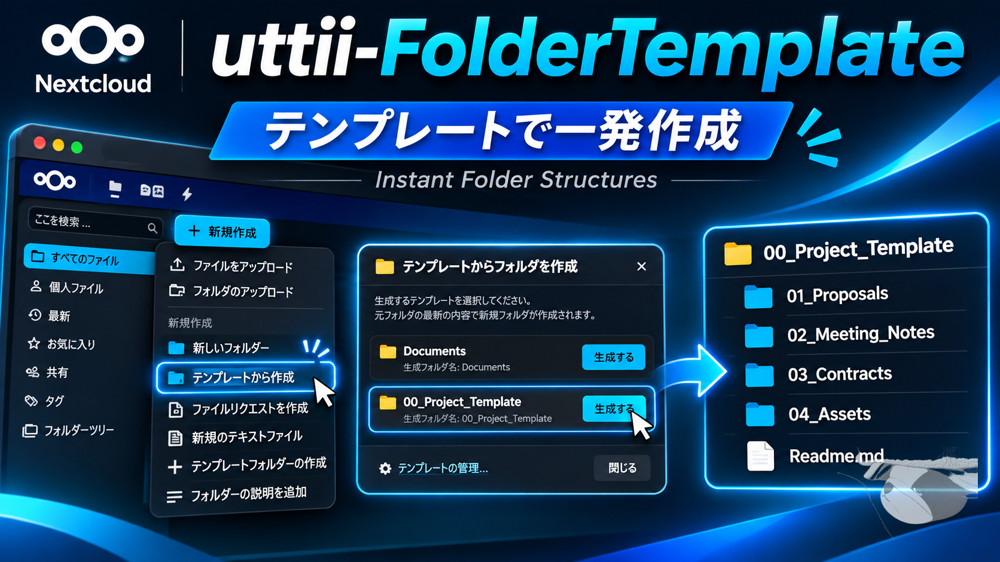
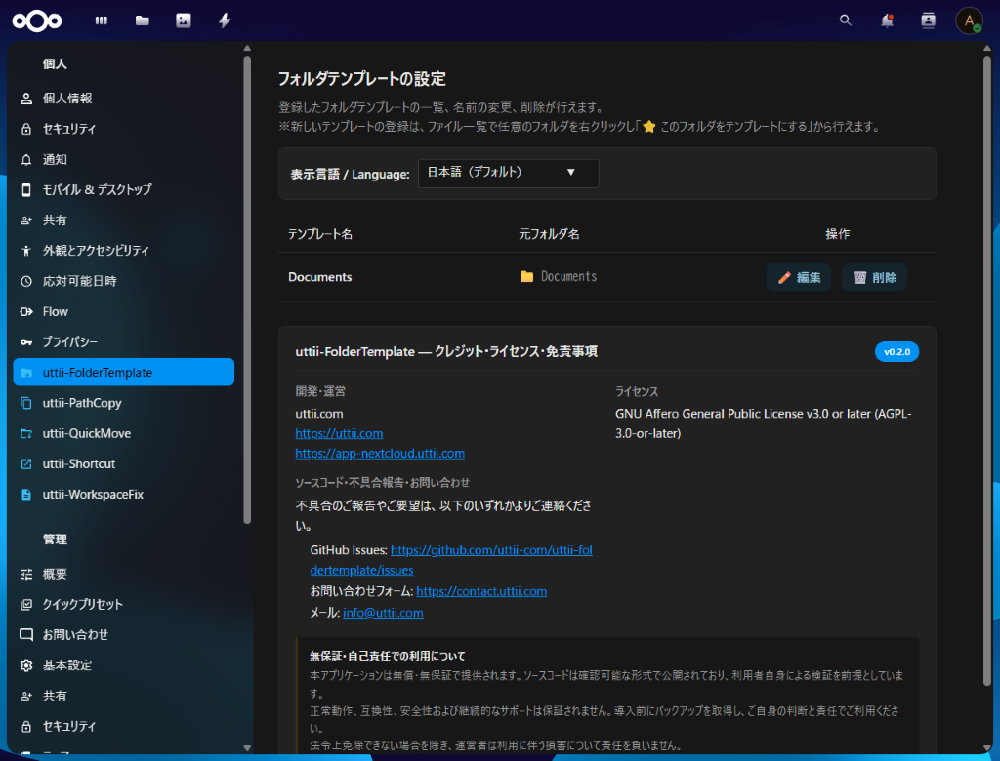

# uttii-FolderTemplate for Nextcloud (`foldertemplate`)

Register existing folders as templates and duplicate the latest folder structure with one click.  
既存フォルダをテンプレートとして登録し、ワンクリックで最新のフォルダ一式を複製作成できるアプリ。

---

## Screenshots / スクリーンショット

| Files UI / ファイル画面 | Personal Settings / 個人設定 |
|---|---|
|  |  |

---

## Features (English)

- **Dynamic Reference (`fileId`-based)**: Updates to the source folder are automatically reflected in every folder created afterward.
- **Move & Rename Resilient**: Tracks the source folder by Nextcloud internal `fileId`, even if moved or renamed.
- **Zero Extra Storage for Templates**: Registering a template stores only a `fileId` reference without duplicating the source folder on the server. *(Note: Newly generated folders created from a template are actual copies and consume normal storage.)*
- **One-Click Creation**: Create folders from the `+` New menu or action bar, with automatic numbering (`Folder (2)`) to prevent overwrites.
- **Settings & Language Switch**: Manage registered templates and switch between Japanese (default) and English in Personal Settings.

## 主な機能・特徴 (日本語)

- **動的参照方式（`fileId` ベース）**: 元フォルダを更新すると、それ以降に作成されるフォルダへ常に最新内容が反映されます。
- **移動・リネーム耐性**: Nextcloud 内部の `fileId` で元フォルダを追跡するため、場所や名前を変更しても動作します。
- **テンプレート保持の追加容量ゼロ**: テンプレートの登録・保持には `fileId` 参照のみを保存するため、元フォルダの複製コピーによるサーバー容量消費がありません。（※テンプレートから新規生成したフォルダ自体は通常どおり実体ファイルとして容量を使用します。）
- **ワンクリック展開と重複防止**: 「＋（新規作成）」メニュー等から即座に生成でき、同名フォルダがある場合は `フォルダ名 (2)` のように自動連番を付与します。
- **設定管理・言語切替**: 個人設定画面からテンプレートの一覧・名前変更・削除、および日本語（デフォルト）／英語の切り替えが可能です。

---

## Requirements / 動作要件

- **Nextcloud Server**: 28 – 35
- **PHP**: 8.0 or higher (8.2 / 8.3 recommended)
- **Dependencies**: Nextcloud core APIs only (no custom database tables or external libraries required)

---

## Installation / インストール方法

### From Nextcloud App Store (Coming Soon / 公開準備中)
Currently preparing for Nextcloud App Store submission. Once published, you will be able to search for **uttii-FolderTemplate** in Nextcloud **Apps** and click **Download and enable**.  
現在 Nextcloud App Store への登録準備中です。公開後は Nextcloud の「アプリ」画面から **uttii-FolderTemplate** を検索して有効化できるようになります。

### From Release Archive (`.tar.gz`)
1. Download `foldertemplate-v0.2.0.tar.gz` from [app-nextcloud.uttii.com](https://app-nextcloud.uttii.com/) *(GitHub Releases is also being prepared)*.
2. Extract it into your Nextcloud `apps` (or `custom_apps`) directory:
   ```bash
   cd /var/www/nextcloud/apps
   sudo tar -xzf /path/to/foldertemplate-v0.2.0.tar.gz
   sudo chown -R www-data:www-data foldertemplate
   ```
3. Enable the app:
   ```bash
   sudo -u www-data php /var/www/nextcloud/occ app:enable foldertemplate
   ```

---

## Configuration / 設定・言語切り替え

Open **Personal settings → uttii-FolderTemplate** to:
- Switch display language between **Japanese (default)** and **English**
- Manage app-specific settings and view license/credit information

個人設定画面の **「uttii-FolderTemplate」** から、表示言語の切り替え（日本語デフォルト／英語）や各種設定を行えます。

---

## Uninstallation / アンインストール方法

```bash
sudo -u www-data php /var/www/nextcloud/occ app:disable foldertemplate
sudo rm -rf /var/www/nextcloud/apps/foldertemplate
```

---

## Bug Reports & Contact / 不具合報告・お問い合わせ

Please report bugs or feature requests via any of the following:
- **GitHub Issues**: [https://github.com/uttii-com/uttii-foldertemplate/issues](https://github.com/uttii-com/uttii-foldertemplate/issues)
- **Contact Form**: [https://contact.uttii.com](https://contact.uttii.com)
- **Email**: [info@uttii.com](mailto:info@uttii.com)

---

## License & Disclaimer / ライセンス・免責事項

- **License**: GNU Affero General Public License v3.0 or later (`AGPL-3.0-or-later`) — see [LICENSE](./LICENSE).
- **Copyright**: (C) 2026 [uttii.com](https://uttii.com)

### Disclaimer (No Warranty & Self-Responsibility)
This application is provided free of charge on an "AS IS" basis without warranty of any kind. Its source code is publicly available for user verification. Normal operation, compatibility, security, and continuous support are not guaranteed. Please take backups before installation and use at your own discretion and risk. Except where liability cannot be excluded by law, the operator shall not be liable for any damages arising from its use.

### 無保証・自己責任での利用について
本アプリケーションは無償・無保証で提供されます。ソースコードは確認可能な形式で公開されており、利用者自身による検証を前提としています。
正常動作、互換性、安全性および継続的なサポートは保証されません。導入前にバックアップを取得し、ご自身の判断と責任でご利用ください。
法令上免除できない場合を除き、運営者は利用に伴う損害について責任を負いません。
